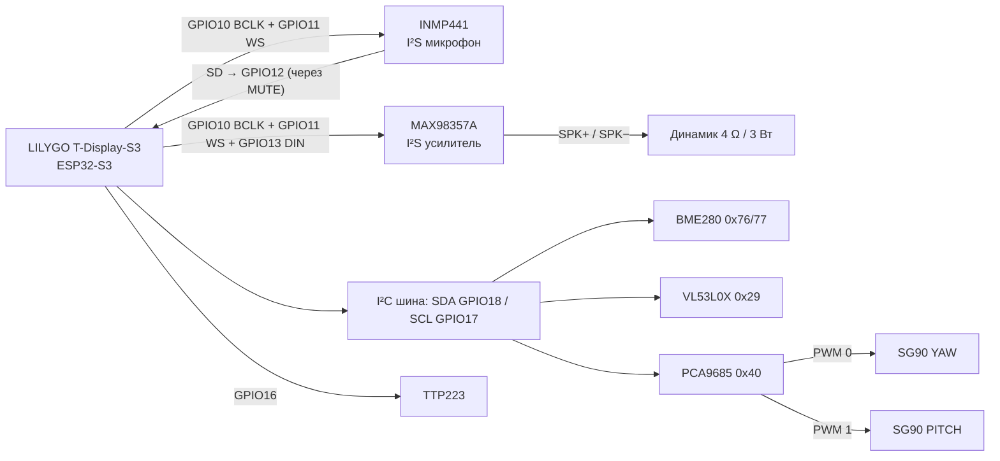
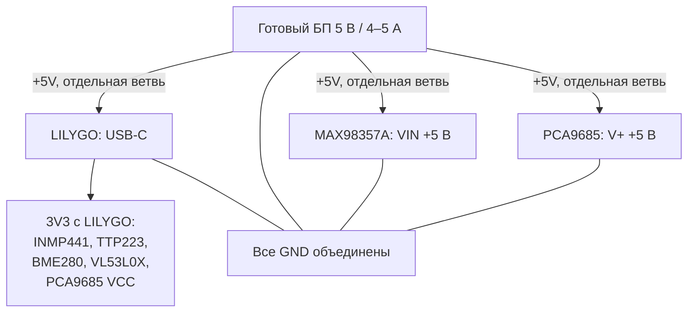

# DeskPet — схема подключений v0.1

> **Проектный вариант, не проверен на реальной сборке.** Для обычной LILYGO T-Display-S3 (LCD ST7789), без Touch/AMOLED/SD Shield. Сверяйте маркировку купленных breakout-модулей перед подачей питания.

## Общее подключение

## I²S1: микрофон и звук

| GPIO платы | Сеть | Подключение |
|---|---|---|
| **GPIO10** | BCLK | INMP441 **SCK** + MAX98357A **BCLK** |
| **GPIO11** | WS | INMP441 **WS** + MAX98357A **LRC** |
| **GPIO12** | MIC_SD (RX) | INMP441 **SD** через аппаратный MUTE |
| **GPIO13** | AMP_DIN (TX) | MAX98357A **DIN** |
| **3V3** | MIC_3V3 | INMP441 **VDD** через MUTE |
| **GND** | земля | INMP441 **GND**, **L/R** (левый канал) |
| **+5V, GND** | усилитель | MAX98357A **VIN**, **GND**, отдельная ветвь источника |
| **SPK+ / SPK−** | мостовой выход | два контакта динамика **4 Ом / 3 Вт** |

**MUTE:** переключатель **DPDT ON-OFF** разрывает двумя независимыми контактными группами **3V3 → VDD** микрофона и **INMP441 SD → GPIO12**. На стороне GPIO12 установить **100 кОм на GND**. Не соединять выход SPK− с GND! Для финального устройства проверить электрическую изоляцию аудиотракта (возможна паразитная подпитка через BCLK/WS).

**Прошивка:** аудио планируется на I²S1 (общие BCLK/WS, раздельные RX/TX), отдельно от дисплейного драйвера; совместимость с используемым LovyanGFX и одновременной работой Wi-Fi/BLE требуется проверить на аппаратуре.

## I²C: датчики и PWM

| GPIO платы | Сеть | BME280 | VL53L0X | PCA9685 |
|---|---|---|---|---|
| **GPIO18** | SDA | SDA | SDA | SDA |
| **GPIO17** | SCL | SCL | SCL | SCL |
| **3V3** | VCC | VCC/VIN* | VCC/VIN* | **VCC** (только логика) |
| **GND** | GND | GND | GND | GND |

Адреса устройств по умолчанию: BME280 **0x76/0x77**, VL53L0X **0x29**, PCA9685 **0x40**. Позднее можно поставить SCD40 (**0x62**). `*` Проверить, поддерживают ли **конкретные** модули питание 3,3 В. I²C подтягивать **только к 3V3**, учитывать уже установленные подтяжки на модулях.

## TTP223, серво и питание

- **GPIO16 → TTP223 OUT**; TTP223 **VCC → 3V3**, **GND → GND** (только обычная LCD-версия платы).
- **PCA9685 PWM0 → SG90 №1** (поворот головы), **PWM1 → SG90 №2** (наклон головы).
- **PCA9685 VCC = 3,3 В логики**, **PCA9685 V+ = отдельные +5 В для сервоприводов**. Не объединять VCC и V+.
- Динамик **4 Ом / 3 Вт** между SPK+ и SPK− MAX98357A, **не на GND**.

На вход V+ PCA9685 установить **C1 680–1000 мкФ / ≥10 В** между V+ и GND (соблюдать полярность). Возле усилителя может понадобиться локальная ёмкость **100–220 мкФ + 100 нФ**, если их нет в модуле. При отладке с Mac, когда питание ESP идёт по USB компьютера, серво можно питать отдельным адаптером: **соединить GND, но не объединять +5 В источников**. Не питать серво через вывод 5V/3V3 платы, не подключать внешний +5V к выводу платы одновременно с USB без проверки схемы питания.

## GPIO — исключения

- Экран использует **GPIO5–9, 15, 38–42, 45–48**; не применять их для периферии.
- **GPIO0 / BOOT, GPIO14 / USER** уже используются кнопками; **GPIO4** — контроль батареи.
- **GPIO11/12/13** могут использоваться дополнением **SD Shield**; наша разводка с этим шилдом несовместима.
- **GPIO16/21** могут быть задействованы в варианте **Touch**; схема рассчитана на обычную плату.
- **GPIO43/44** оставлены под UART; **GPIO3** — strapping, избегать без проверки.

## Проверка по шагам

1. Установить и проверить только LILYGO по USB; убедиться в работоспособности экрана и обеих кнопок.
2. Подключить I²C и проверить адреса `0x29`, `0x40`, `0x76/0x77` сканером.
3. Протестировать TTP223.
4. Проверить INMP441 и отдельный MUTE, затем усилитель и динамик на малой громкости.
5. Подключить 5-вольтовую силовую линию серво, сначала один привод, затем второй.
6. Измерить ток, падение питания, проверить отсутствие перезагрузок и конфликтов аудио/графики/Wi-Fi/BLE.

## Первоисточники

- [LILYGO T-Display-S3 — документация и pinout](https://wiki.lilygo.cc/products/t-display-series/t-display-s3/)
- [Espressif ESP32-S3 — I²S](https://docs.espressif.com/projects/esp-idf/en/stable/esp32s3/api-reference/peripherals/i2s.html)
- [Adafruit MAX98357A — распиновка](https://learn.adafruit.com/adafruit-max98357-i2s-class-d-mono-amp/pinouts)
- [Adafruit PCA9685 — питание VCC/V+](https://learn.adafruit.com/16-channel-pwm-servo-driver/hooking-it-up)

**Схема не является проверенным проектом PCB; перед изготовлением платы необходимы испытания прототипа и проверка конкретных модулей.**
